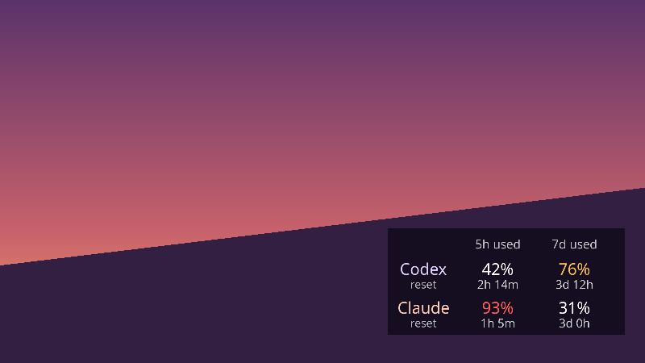
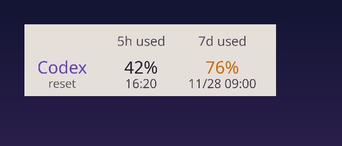
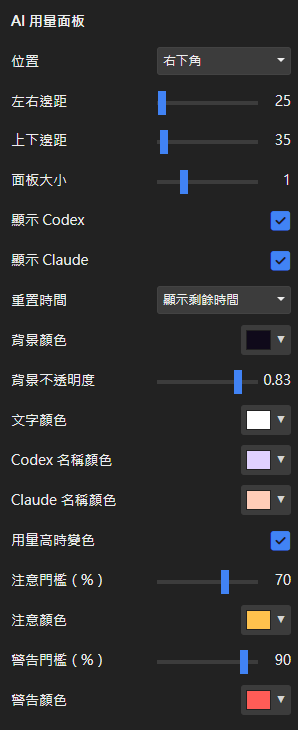

# Wallpaper AI Usage

[English](README.md) | 正體中文

在 Wallpaper Engine 場景桌布的角落顯示 Codex 和 Claude Code 的用量。面板列出 5 小時和 7 天兩種額度的已用百分比，還有離重置剩多久。用量到 70% 變橘黃色，到 90% 變紅色。

位置、大小、顏色、顯示哪幾列和變色門檻，都能在桌布設定裡調整。

安裝程式會把你選的場景複製一份到本機。Wallpaper Engine 負責畫面板，數字靠兩個 CLI 原本的 hook 更新。

## 需要什麼

- Windows 上的 Wallpaper Engine，加上一張要放面板的 2D 場景桌布
- WSL，裝好 Python 3.10 以上，並開啟 Windows interop
- Codex CLI 要用 ChatGPT 帳號登入，Claude Code 要登入會回報用量上限的方案。只用其中一個也行。

下面的指令都在 WSL 裡執行。先開一次 Wallpaper Engine 的桌布編輯器，它才會建立本機的專案資料夾。

## 加上面板

1. 在 Wallpaper Engine 對場景按右鍵，選「在檔案總管中開啟」，這個資料夾就是來源。自己做的場景和工作坊下載的場景都能用。
2. Clone 這個 repo，把指令裡的兩個範例路徑換成你的，再執行安裝程式。想放在 Monitor0 以外的螢幕，到 Wallpaper Engine 安裝資料夾的 `config.json` 查螢幕編號。

   ~~~sh
   git clone https://github.com/KageRyo/wallpaper-ai-usage.git
   cd wallpaper-ai-usage
   python3 wallpaper_usage.py install '/mnt/c/path/to/source-wallpaper' \
     --engine '/mnt/c/Program Files (x86)/Steam/steamapps/common/wallpaper_engine' \
     --monitor Monitor0
   ~~~

3. 在 Wallpaper Engine 把標題結尾是「AI Usage」的副本套用到那個螢幕。

## 連接 Codex 和 Claude Code

下面這行會依照你的 clone 位置和安裝路徑，印出要貼的設定：

~~~sh
python3 wallpaper_usage.py hooks
~~~

- Codex：把印出的兩筆設定併進 `~/.codex/hooks.json` 的 `hooks`，沒有這個檔案就直接用印出的範例建立。接著在 Codex 開啟 `/hooks`，信任這兩個指令。它們會在 session 開始時和模型每次回應後執行，兩次查詢帳號用量至少隔 12 秒。
- Claude Code：把印出的 `statusLine` 加進 `~/.claude/settings.json`。每次 API 回應後，Claude Code 會把最新用量交給面板。你已經有自訂狀態列的話，先把原本的 `command` 填進下面的指令，再複製它印出的設定，原本的狀態列會收到一樣的輸入。

~~~sh
python3 wallpaper_usage.py hooks --claude-command 'bash ~/.claude/my-statusline.sh'
~~~

套用副本後執行 `python3 wallpaper_usage.py codex --force`，Codex 的數字會馬上更新。Claude 那一列要等 Claude Code 回報用量才會出現。倒數用的是兩邊回報的重置時間。

## 自訂面板

在 Wallpaper Engine 選取副本，捲到右側設定清單最下面的「AI 用量面板」，改了馬上生效。設定名稱跟著 Wallpaper Engine 的介面語言，目前有英文和正體中文，其他語言會顯示英文。

| 設定 | 調整什麼 |
| --- | --- |
| 位置 | 面板放在哪個角落 |
| 左右邊距、上下邊距 | 面板和螢幕邊緣的距離，單位是 1080p 螢幕上的像素 |
| 面板大小 | 0.5 到 2.5 倍 |
| 顯示 Codex、顯示 Claude | 關掉用不到的那一列，面板會跟著變矮 |
| 重置時間 | 顯示剩餘時間（例如 2h 14m）或重置時刻（例如 16:20） |
| 背景顏色、背景不透明度 | 面板背景 |
| 文字顏色、Codex 名稱顏色、Claude 名稱顏色 | 文字顏色 |
| 用量高時變色 | 開啟或關閉變色 |
| 注意門檻、注意顏色 | 預設 70%、橘黃色 |
| 警告門檻、警告顏色 | 預設 90%、紅色 |

## 移除面板

在 Wallpaper Engine 換回原本的桌布。刪掉 Codex 的兩筆 hook，把 Claude Code 的狀態列改回原本的設定，再刪除本機的桌布副本和 `~/.config/wallpaper-ai-usage` 資料夾。hook 還在用的時候，別搬動這份 clone。

## 開發

在專案資料夾執行 `python3 -m unittest discover -s tests`。測試會用暫存的場景和設定檔。面板版面測試另外需要 Node.js，沒裝就會跳過。

## 授權

[MIT](LICENSE)
